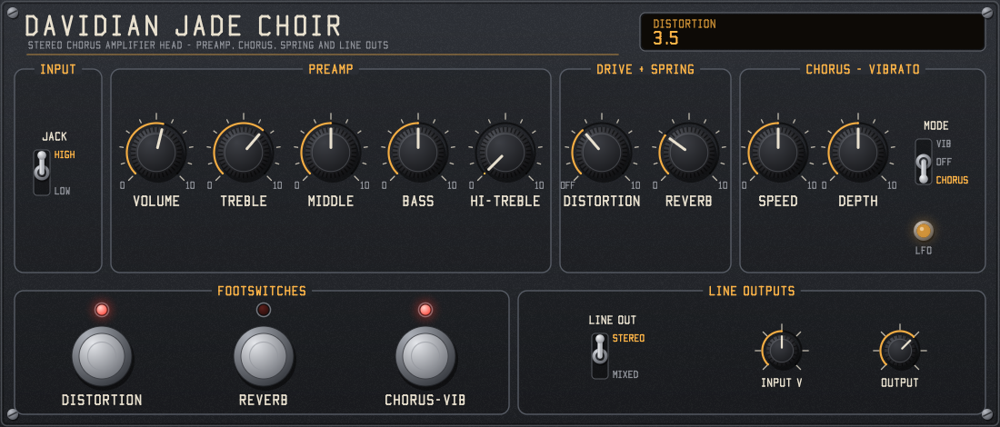

# Davidian Jade Choir

A circuit-modelled stereo chorus amplifier plugin (LV2, VST3 and Audio Unit), modelled part by part on the circuit diagram of a classic 1984 stereo chorus amplifier head: the input stage, the switchable diode-clipper distortion, the tone stack with hi-treble, the BBD chorus/vibrato with its LFO and JFET switching, the spring reverb drive and recovery, and the two mixers that feed the head's "normal" and "effect" line outputs.

**A close model, not an exact copy.** It simulates the circuit from its component values; it is not sampled or measured from a unit. The model reproduces the signal voltages printed on the schematic to within 6%, but a few parts have no values on the schematic and no published data; those are estimates, listed under [Estimates](#estimates). It has not been compared side by side with a real amplifier.



Mono in, stereo out, no latency. The left output is the **normal** line out: dry plus reverb. The right output is the **effect** line out: the chorus or vibrato signal plus reverb, or the dry signal when the effect is off. Through two speakers (or panned hard left and right) that is the original's spatial chorus: the dry and the delayed signal mix in the air. A stereo input is averaged into the single amplifier input. Every format is built from the same circuit code, shows the same GUI and sounds identical. GPL-3.0-or-later.

| Format | Windows | macOS | Linux |
|---|---|---|---|
| LV2 | yes | yes | yes |
| VST3 | yes | | |
| Audio Unit (AUv2) | | yes | |

## Which amplifier

The circuit diagram this is built from is the 1984 head version (preamp board 70126811): one channel, with a **Hi-Treble** knob where the combo has a Bright switch, a Sub In jack, and line outputs taken before the power amplifier. The combo's owner's manual (two channels, Bright switches, an effects loop) supplied the control functions, but no schematic of the combo's second channel was available, so the plugin follows the head.

## Install

Build it (see [Build](#build)), then copy the plugin folder for your host's format into its plugin folder and restart the host (or rescan plugins):

| Format | Copy | Into |
|---|---|---|
| VST3 (Windows) | `Davidian Jade Choir.vst3` | `C:\Program Files\Common Files\VST3` |
| Audio Unit (macOS) | `Davidian Jade Choir.component` | `~/Library/Audio/Plug-Ins/Components` |
| LV2 (Windows) | `jade_choir.lv2` | `%APPDATA%\LV2` (create it if it doesn't exist) |
| LV2 (macOS) | `jade_choir.lv2` | `~/Library/Audio/Plug-Ins/LV2` |
| LV2 (Linux) | `jade_choir.lv2` | `~/.lv2` |

In the host it is listed as **Davidian Jade Choir** (VST3, LV2) or under **Davidian** as **Jade Choir** (Audio Unit; manufacturer code `Dvdn`, subtype `Jdch`). The LV2 URI is `urn:davidian:jade-choir`.

## Controls

| Panel | Control | Circuit part |
|---|---|---|
| Input | Jack: High / Low | HIGH through R6 33k; LOW through R7 100k with R6 to ground, about 12 dB less |
| Preamp | Volume | VR2 1MB |
| Preamp | Treble, Middle, Bass | VR4 250kB, VR5 10kB, VR6 250kA |
| Preamp | Hi-Treble | VR3 1MB in series with C42 470p, from the treble wiper to the volume wiper |
| Drive + Spring | Distortion | VR1 50kC in IC2a's gain leg (gain 1.9 to 48), with its switch at OFF, which also lifts the diode clippers |
| Drive + Spring | Reverb | VR7 10kB |
| Chorus - Vibrato | Speed, Depth | VR8 100kB, VR9 100kB (vibrato only) |
| Chorus - Vibrato | Mode: Vib / Off / Chorus | S1. Chorus uses a fixed rate and the full depth |
| Footswitches | Distortion, Reverb, Chorus-Vib | The footswitch jacks. On (LED lit) is the same as no footswitch plugged in |
| Line outputs | Line Out: Stereo / Mixed | Mixed is the NORMAL (MIXED) jack used alone: both sides through 5.6k each |
| Line outputs | Input V | Volts at the input jack for a 0 dBFS sample (0.1 to 10, default 1.0) |
| Line outputs | Output | Not on the unit: -24 to +12 dB, default 0 dB. Output 1.0 is the same number of volts as Input V |
| (host) | Enabled | Plugin bypass with a 20 ms crossfade to the dry input on both sides |

The amber LFO lamp follows the chorus/vibrato LFO, read from the plugin's `lfo` output port. The readout shows the name and value of the last control you touched.

Drag a knob up or down, hold Shift to fine-tune, use the mouse wheel, and double-click to reset. Click the upper or lower part of a toggle (or the middle of the three-way) to pick that position.

## How it is modelled

Each stage is a netlist with the schematic's part values (`src/amp.h`), solved by a small circuit simulator (`src/circuit.h`): modified nodal analysis with trapezoidal capacitors, ideal op amps that clip at their output swing, and the antiparallel clipping diodes solved by Newton's method. The stages are joined at op amp outputs. The preamp, up to IC3b, runs at twice the host rate below 88.2 kHz.

- **Input and IC2b:** R6/R7, C12, R19/C19, R20 1M; gain 1 + R18/R16 = 3.56.
- **IC2a, clippers, tone stack and volume** are solved as one circuit, because the stack loads the clippers and, with the footswitch off, the distortion leg returns through the clipper network. Clippers: R32 3.9k to D9/D11 + C32, R43 3.9k to D8/D10 + C33, C31 0.01u. Tone stack: R74 100k, C49 150p, C50 0.082u, C51 0.047u.
- **IC3a** (gain 13.3, C38 rolls it off above 5.9 kHz) and **IC3b** (non-inverting, gain 1.82, after the R59/R58 divider).
- **Chorus/vibrato:** input filter and IC5a treble pre-emphasis, the MN3007 BBD (1024 stages, delay = 512 / clock), the third-order output filter with Q27, and IC5b de-emphasis. LFO: IC8a integrator and IC8b Schmitt trigger, on a single 15 V supply.
- **Switching:** Q18/Q19 drive the JFET switches Q17 (dry to the right mixer) and Q21 (chorus to the right mixer) through their 1M / 0.047u gate networks, so the effect fades in and out over about 50 ms, as on the unit.
- **Reverb:** C34/R29 into the driver, the tank, then C52/R81 and IC4b (gain 7.8), C55, R87 and the REVERB pot into both mixers.
- **Mixers and line outs:** IC1a and IC4a, then C22 (C59) and the power amp's input as the load.

### Checked against the schematic

`test_dsp` drives each stage at the schematic's test conditions (1 kHz; equalizer, hi-treble and volume fully clockwise; distortion at OFF):

| Point | Model | Schematic |
|---|---|---|
| IC2b output, 21 mV at HIGH | 72 mV | 72 mV |
| IC2b output, 85 mV at LOW | 73 mV | 72 mV |
| IC2a output after C30 | 138 mV | 130 mV |
| IC3b output | 286 mV | 290 mV |
| IC5a output (into the BBD) | 748 mV | 760 mV |
| Q27 emitter | 850 mV | 850 mV (sets the BBD's gain) |
| IC5b output | 302 mV | 300 mV |
| BBD delay range | 1.46-6.40 ms | clock 80-350 kHz |
| Fastest vibrato | 227 ms period | 240 ms |

The test also checks every stage's simulation against an independent AC analysis of the same netlist (they agree to within 0.0001 dB, 40 Hz to 6 kHz), and runs the plugin at five sample rates.

Worked out from the circuit: the chorus LFO runs at 0.56 Hz, and vibrato SPEED covers 0.56 to 4.4 Hz. The slow end is a 1.8 s period, where a waveform note on the schematic says "1 sec"; the circuit values give 1.8 s.

### Estimates

These have no values on the schematic and no published data was found, so they are estimates:

- **The spring reverb tank** (`src/fx.h`). It is a three-spring tank with no published specifications. The model is a generic three-spring reverb: transit times 29.5, 33.7 and 37.1 ms, a 2.5 s decay (middle of the usual "medium decay" range), dispersion from 24 stretched all-pass filters per spring, a 4.5 kHz loop low-pass, and an overall level of 0.25. The driver is taken as flat, because its response depends on the tank's coil, which is also unknown. This is the largest departure from the hardware.
- **BBD clock law.** The schematic gives the clock range (80-350 kHz) but not how it follows the LFO voltage; the delay is taken as linear in the control voltage, spanning the full range over the full triangle.
- **Pot tapers:** A (audio) taper 15% at half rotation, C taper 85%.
- **JFET switches:** 2SK117 pinch-off -0.85 V (middle of the datasheet's -0.2 to -1.5 V) and 100 ohm channel resistance. Neither changes the sound: they only set the exact timing of the 50 ms fade.
- **Datasheet typicals:** op amp swing +/-14 V (NJM4558, a listed substitute for the M5218), 1V from each rail on IC8's single supply; diodes modelled as the 1N4148 (the 1S2473's equivalent).

### Not modelled

- **Q35/Q36**, which sense the right speaker output and feed IC8b's reference. They are not legible enough on the scan to model; the plugin takes IC8b's reference as the bias line, so the LFO always runs.
- **The power amplifiers and speakers.** The outputs are the line outputs, which the head takes before the power amp.
- The power-on muting (Q5, Q20), the Sub In jack and the input protection diodes. They don't affect the sound in normal use.
- The BBD's own sampling: it is a clean variable delay. At these clock rates its images are far above the output filter.

## Build

The LV2 build is plain C11 (the macOS window layer is compiled as Objective-C) and needs no LV2 SDK or other libraries. The VST3 and the Audio Unit need their SDKs, which CMake downloads while configuring: the Steinberg VST3 SDK 3.8.1 (MIT) and Apple's AudioUnitSDK 1.2.0 (Apache 2.0).

| Source | What it is |
|---|---|
| `src/circuit.h` | The circuit simulator |
| `src/amp.h` | The amplifier's stages as netlists, with the schematic's part values |
| `src/fx.h` | LFO, BBD delay, JFET switch timing, reverb tank, oversampling filters |
| `src/engine.c`, `src/engine.h` | Routing, controls and the per-sample loop, behind a small C API that every format uses |
| `src/params.h`, `src/ports.h` | Parameter names, ranges and text for VST3 and Audio Units, and the LV2 port numbers they match |
| `src/plugin.c`, `src/ui/ui_lv2.c` | LV2 plugin and GUI |
| `src/vst3/` | VST3 processor, controller and editor, and its CMake build |
| `src/au/` | Audio Unit, its Cocoa view and its Info.plist |
| `src/ui/panel.h`, `src/ui/view.c` | The panel and the window layer under it (Win32, Cocoa, X11), shared by every GUI |
| `src/ui/canvas.h`, `src/ui/font.h`, `src/ui/style.h` | Davidian GUI house style: software renderer, stroke font and palette |
| `src/lv2_abi.h` | The LV2 C interface, so no SDK is needed |
| `bundle/` | LV2 metadata |
| `licenses/` | The VST3 SDK and AudioUnitSDK licences, shipped inside the bundles that use them |

### Windows (Visual Studio)

Needs Visual Studio 2017 or later with the C++ tools. `build.bat` builds the LV2 bundle, `build\jade_choir.lv2`, and the Windows-only LV2 checks, without CMake.

```bash
build.bat
```

### Every platform (CMake)

Needs CMake 3.25 or later and a C/C++ compiler. On macOS, the Xcode command-line tools; add `-DCMAKE_OSX_ARCHITECTURES="arm64;x86_64"` for a universal build. On Linux, gcc or clang plus the X11 headers (`libx11-dev` on Debian/Ubuntu) for the GUI; without them CMake builds the plugin alone.

```bash
cmake -S . -B build-cmake -DCMAKE_BUILD_TYPE=Release
```

```bash
cmake --build build-cmake --config Release
```

The VST3 lands in `build-cmake\VST3\Release` (Windows) and the Audio Unit in `build-cmake/AU` (macOS, signed ad hoc). They are on by default on Windows and macOS respectively; turn them off with `-DJADE_CHOIR_VST3=OFF` or `-DJADE_CHOIR_AU=OFF`.

## Tests

Windows, with `build.bat`:

```bash
build-test\test_dsp.exe build\jade_choir.lv2
```

```bash
build-test\lilv_check.exe build
```

```bash
build-test\ui_check.exe build\jade_choir.lv2
```

Every platform, with CMake:

```bash
ctest --test-dir build-cmake -C Release
```

- `test_dsp` checks the stages against AC analysis and the schematic's signal levels, the LFO and BBD, and the built LV2 library (chorus routing, distortion, bypass, every sample rate, CPU time).
- `ui_render` draws the panel to a BMP file without opening a window: `build-test\ui_render.exe out.bmp`.
- `ui_check` (Windows) hosts the built GUI and drives it with mouse messages.
- `lilv_check` (Windows) validates the bundle with the lilv LV2 parser (from an Ardour 9 install).
- `params_check` checks the VST3 and Audio Unit parameters against the LV2 ports and the panel.
- `vst3_check` (Windows) hosts the VST3, drives its editor and compares its sound with the LV2 build. The VST3 build also runs Steinberg's validator.
- `au_check` (macOS) loads the Audio Unit, compares its sound with the LV2 build and opens its view.

CPU: about 6% of one core at 48 kHz with the default settings, about 11% with heavy distortion (measured on the development machine).

## Use of AI

Made with generative AI (Claude Code), directed and reviewed by Davidian. See [AI_USAGE.md](AI_USAGE.md) for what the author and the AI each did, and what has and hasn't been checked.

## Licence

GPL-3.0-or-later. See [LICENSE](LICENSE), [NOTICE.md](NOTICE.md) and [AI_USAGE.md](AI_USAGE.md). `src/lv2_abi.h` is under the ISC licence, which is GPL-compatible, because it reproduces the LV2 interface declarations. The VST3 plugin includes code from the Steinberg VST3 SDK (MIT) and the Audio Unit from Apple's AudioUnitSDK (Apache 2.0), both GPL-3.0-compatible. The build copies `LICENSE`, `NOTICE.md` and `AI_USAGE.md` into every bundle. VST is a registered trademark of Steinberg Media Technologies GmbH.
